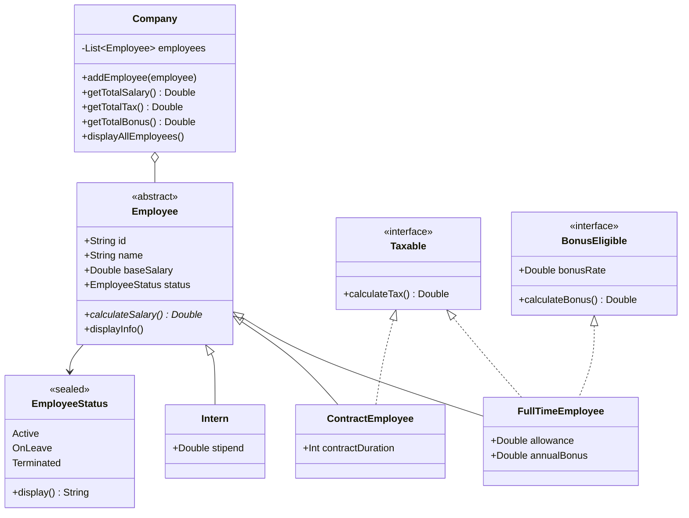
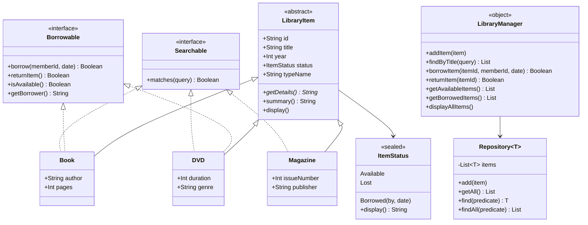

# Studi Kasus Latihan Pertemuan 5

Latihan mata kuliah **Pemrograman Berorientasi Objek (OOP)** dengan topik **abstraksi dan interface**, ditulis dalam **Kotlin**. Repositori ini berisi dua studi kasus dalam satu proyek:

| Studi kasus | Jenis | Topik |
|---|---|---|
| **Sistem Manajemen Pegawai** | Individu | Abstract class, interface + default method, multiple interface, sealed class |
| **Sistem Manajemen Perpustakaan** | Kelompok | Abstract class, multiple interface, sealed class, generic `Repository<T>`, exception handling |

---

## Daftar Isi

- [Tujuan Pembelajaran](#tujuan-pembelajaran)
- [Struktur Proyek](#struktur-proyek)
- [Studi Kasus Individu: Sistem Manajemen Pegawai](#studi-kasus-individu-sistem-manajemen-pegawai)
- [Studi Kasus Kelompok: Sistem Manajemen Perpustakaan](#studi-kasus-kelompok-sistem-manajemen-perpustakaan)
- [Cara Menjalankan](#cara-menjalankan)
- [Contoh Output](#contoh-output)
- [Catatan Desain](#catatan-desain)

---

## Tujuan Pembelajaran

- Menerapkan **abstract class** dengan metode abstrak dan konkret.
- Menerapkan **interface** dengan default method.
- Menerapkan **multiple interface** pada kelas yang sesuai.
- Menggunakan **sealed class** untuk status, lengkap dengan `when` ekshaustif.
- Menerapkan **enkapsulasi** dan **polimorfisme** dalam satu kesatuan.
- Menerapkan **generic** (`Repository<T>`), **collection**, dan **exception handling** (`runCatching`).

---

## Struktur Proyek

```
src/
├── Main.kt                          # menjalankan kedua demo
├── model/
│   ├── Employee.kt                  # abstract class Employee            (individu)
│   ├── LibraryItem.kt               # abstract class LibraryItem         (kelompok)
│   ├── interfaces/
│   │   ├── Taxable.kt               # interface pajak (default 5%)
│   │   ├── BonusEligible.kt         # interface bonus
│   │   ├── Borrowable.kt            # interface dapat dipinjam
│   │   └── Searchable.kt            # interface dapat dicari
│   ├── status/
│   │   ├── EmployeeStatus.kt        # sealed class status pegawai
│   │   └── ItemStatus.kt            # sealed class status item perpustakaan
│   ├── subclasses/
│   │   ├── FullTimeEmployee.kt
│   │   ├── ContractEmployee.kt
│   │   ├── Intern.kt
│   │   ├── Book.kt
│   │   ├── Magazine.kt
│   │   └── DVD.kt
│   └── manager/
│       ├── Company.kt               # pengelola pegawai
│       └── LibraryManager.kt        # pengelola perpustakaan + Repository<T>
└── exception/
    └── CustomExceptions.kt          # exception khusus perpustakaan
```

Setiap folder memiliki `package` dengan nama yang sama (`model.interfaces`, `model.status`, dan seterusnya).

---

## Studi Kasus Individu: Sistem Manajemen Pegawai

Sebuah perusahaan memiliki tiga jenis pegawai dengan aturan penghitungan yang berbeda:

| Jenis | Gaji | Pajak | Bonus |
|---|---|---|---|
| `FullTimeEmployee` | gaji pokok + tunjangan | ya (5%) | ya (bonus tahunan) |
| `ContractEmployee` | gaji pokok | ya (5%) | tidak |
| `Intern` | uang saku | tidak | tidak |

Status pegawai: **Aktif**, **Cuti**, atau **Berhenti** (`EmployeeStatus`).

### Diagram kelas



### Cara kerja singkat

- `Employee` menyimpan sifat yang sama untuk semua pegawai. Rumus gaji dibiarkan abstrak (`calculateSalary()`) dan diisi tiap subclass.
- `Taxable` dan `BonusEligible` adalah kemampuan yang hanya dimiliki sebagian pegawai.
- `Company` menyimpan semua pegawai dalam satu `List<Employee>` (polimorfisme) dan memakai `filterIsInstance<Taxable>()` serta `filterIsInstance<BonusEligible>()` untuk menghitung total pajak dan bonus.

---

## Studi Kasus Kelompok: Sistem Manajemen Perpustakaan

Perpustakaan kampus memiliki tiga jenis koleksi:

| Koleksi | Dapat dipinjam | Dapat dicari |
|---|---|---|
| `Book` | ya | ya (judul / penulis) |
| `Magazine` | tidak | ya (judul / penerbit) |
| `DVD` | ya | ya (judul / genre) |

Status item: **Tersedia**, **Dipinjam** (oleh siapa dan tanggal), atau **Hilang** (`ItemStatus`).

### Diagram kelas



### Exception khusus

| Exception | Dilempar ketika |
|---|---|
| `ItemNotFoundException` | ID item tidak ditemukan |
| `ItemAlreadyBorrowedException` | item sedang dipinjam (atau tidak tersedia) |
| `ItemNotBorrowedException` | item dikembalikan padahal tidak sedang dipinjam |
| `ItemNotBorrowableException` | item memang tidak bisa dipinjam (contoh: majalah) |

`LibraryManager.borrowItem()` dan `returnItem()` dibungkus `runCatching`: bila gagal, pesan `❌ ...` dicetak, hasilnya `false`, dan program tidak berhenti.

---

## Cara Menjalankan

### Prasyarat

- JDK 17 atau lebih baru
- Kotlin (disarankan versi terbaru) atau IntelliJ IDEA

### Dengan IntelliJ IDEA

1. Buat project Kotlin baru, atau buka folder ini.
2. Pastikan folder `src/` ditandai sebagai *Sources Root*.
3. Jalankan fungsi `main()` di `src/Main.kt` dengan tombol ▶.

### Dengan command line (bash / Git Bash)

```bash
kotlinc $(find src -name '*.kt') -include-runtime -d latihan.jar
java -jar latihan.jar
```

### Menjalankan satu studi kasus saja

`main()` di `Main.kt` memanggil kedua demo:

```kotlin
fun main() {
    runEmployeeDemo()      // Studi Kasus Individu
    println()
    runLibraryDemo()       // Studi Kasus Kelompok
}
```

Beri komentar `//` di depan salah satu pemanggil untuk menjalankan satu studi kasus saja.

---

## Contoh Output

### Sistem Manajemen Pegawai

```
=== Daftar Pegawai PT Maju Jaya ===
ID: P001, Nama: Budi
Gaji Pokok: Rp 5000000.0
Gaji Total: Rp 6500000.0
Status: Aktif
---
ID: P002, Nama: Siti
Gaji Pokok: Rp 4500000.0
Gaji Total: Rp 4500000.0
Status: Aktif
---
ID: P003, Nama: Ahmad
Gaji Pokok: Rp 0.0
Gaji Total: Rp 2000000.0
Status: Aktif
---
Total Gaji: Rp 13000000.0
Total Pajak: Rp 550000.0
Total Bonus: Rp 6000000.0
```

Rincian perhitungan:

| Pegawai | Gaji total | Pajak (5%) | Bonus |
|---|---|---|---|
| Budi (tetap) | 5.000.000 + 1.500.000 = 6.500.000 | 325.000 | 6.000.000 |
| Siti (kontrak) | 4.500.000 | 225.000 | – |
| Ahmad (magang) | 2.000.000 | – | – |

### Sistem Manajemen Perpustakaan

```
=== SISTEM MANAJEMEN PERPUSTAKAAN ===
[P001] Pemrograman Kotlin (2023) - Tersedia
   Detail: Buku oleh Budi Santoso, 350 halaman
[P002] Dasar-Dasar OOP (2022) - Tersedia
   Detail: Buku oleh Siti Rahayu, 280 halaman
[M001] Tech Today (2024) - Tersedia
   Detail: Majalah edisi #42, diterbitkan oleh Tech Media
[D001] Film Dokumenter (2021) - Tersedia
   Detail: DVD, 120 menit, genre: Dokumenter

--- Meminjam Buku P001 oleh M001 ---
✅ Buku 'Pemrograman Kotlin' dipinjam oleh M001 pada 2025-01-15

--- Mencari 'Kotlin' ---
[P001] Pemrograman Kotlin (2023) - Dipinjam oleh M001 pada 2025-01-15

--- Mengembalikan Buku P001 ---
✅ Buku 'Pemrograman Kotlin' dikembalikan

--- Item Tersedia ---
[P001] Pemrograman Kotlin (2023) - Tersedia
[P002] Dasar-Dasar OOP (2022) - Tersedia
[M001] Tech Today (2024) - Tersedia
[D001] Film Dokumenter (2021) - Tersedia
```

Uji skenario error (bagian tambahan di akhir demo):

```
=== UJI SKENARIO ERROR ===

--- Pinjam item yang tidak ada (X999) ---
❌ Item dengan ID 'X999' tidak ditemukan

--- Pinjam item yang sudah dipinjam (P002 oleh M002, lalu M003) ---
✅ Buku 'Dasar-Dasar OOP' dipinjam oleh M002 pada 2025-01-16
❌ Item 'Dasar-Dasar OOP' sedang dipinjam oleh M002

--- Kembalikan item yang tidak dipinjam (D001) ---
❌ Item 'Film Dokumenter' tidak sedang dipinjam

--- Pinjam Majalah M001 (tidak bisa dipinjam) ---
❌ Item 'Tech Today' tidak dapat dipinjam

--- Item Dipinjam ---
[P002] Dasar-Dasar OOP (2022) - Dipinjam oleh M002 pada 2025-01-16
```

> Jika emoji `✅` / `❌` tampil sebagai `?` di terminal, atur encoding output ke UTF-8 (misalnya `java -Dfile.encoding=UTF-8 -jar latihan.jar`).

---

## Catatan Desain

- **`Taxable` dan `BonusEligible` memakai `(this as Employee)`** agar default method bisa memanggil `calculateSalary()`. Cara ini mengikuti panduan di soal. Kelemahannya, kelas non-`Employee` yang mengimplementasikan interface tersebut akan gagal saat dijalankan. Alternatif yang lebih aman adalah menambahkan `fun calculateSalary(): Double` sebagai metode abstrak di interface.
- **`FullTimeEmployee.bonusRate = 0.0` tidak dipakai**, karena `calculateBonus()` di-override menjadi `annualBonus` (bonus tetap).
- **`Repository<T>` ditulis di `LibraryManager.kt`**, karena struktur folder yang ditentukan hanya menyebut `LibraryManager.kt` di folder `manager/`.
- **`ItemNotBorrowableException`** adalah tambahan di luar tiga exception yang diminta soal, untuk kasus meminjam majalah.
- **`typeName` dan `summary()` pada `LibraryItem`** ditambahkan agar pesan menyesuaikan jenis item ("Buku", "DVD") dan hasil pencarian tampil satu baris sesuai contoh output.
- **`plain()` di `Main.kt`** memaksa angka besar tampil sebagai `13000000.0`, bukan `1.3E7` (perilaku bawaan `Double` di Kotlin untuk angka mulai 10 juta).
